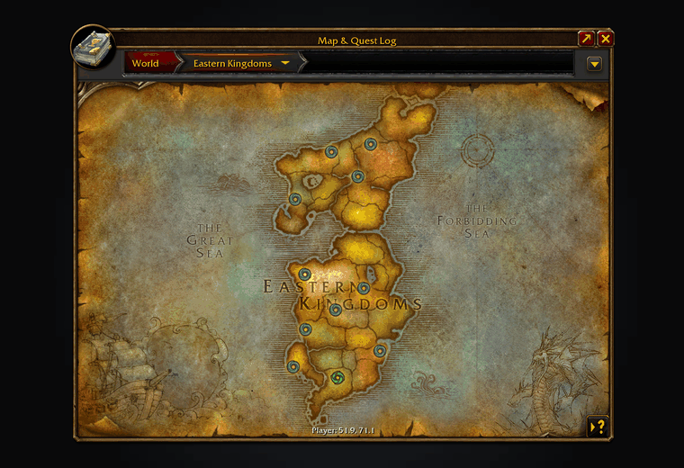
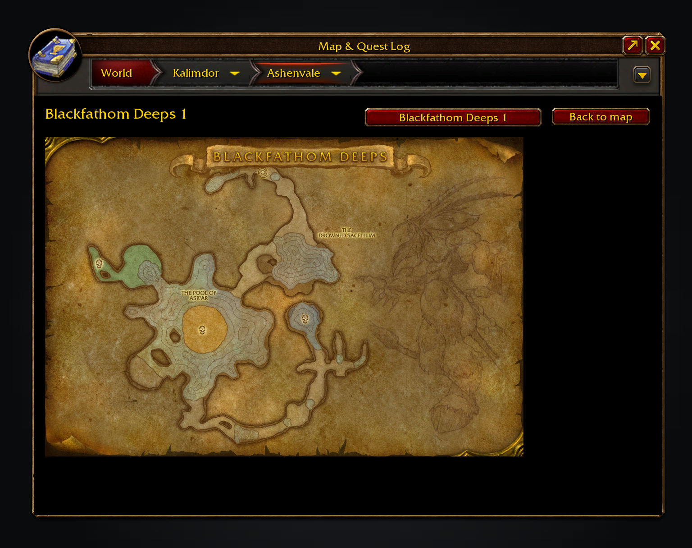
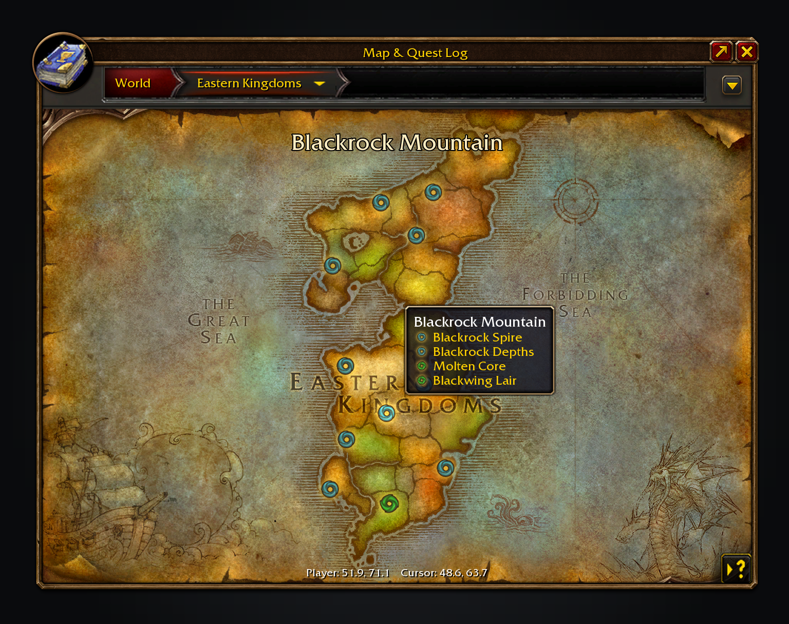
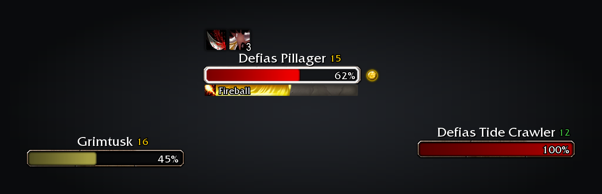

Tweaks Forever can accept and turn in quests, standing down while Polestar does. It can name rares near you in chat, and it repairs and sells junk at merchants. Gear groups, maps, nameplates and more sit beside them in the game's settings.

If you already run Polestar, Naowh Forever, Leatrix Plus, OpenMap, Questie, BlizzMove, Peddler or similar, the overlapping option greys out and names that addon. Repairs, selling junk and faster auto loot start on; everything else that acts for you starts off.

Free, with nothing locked behind it. If it saves you time, you can [sponsor me on GitHub](https://github.com/sponsors/cjber), which takes no fees, or [buy me a coffee on Ko-fi](https://ko-fi.com/cjber). For help and each day's release notes, [join me on Discord](https://discord.gg/FpHugGxRJY).

  

The junk coin marks what sells with your greys at a merchant. Also dungeon entrances and nameplates.

Inside a dungeon or raid the map opens on its painted parchment sheet. Click an entrance to see one from outside.

Every dungeon and raid entrance, with retail's icons. Blackrock Mountain lists all four.

Nameplates in retail's own frame, with your target outlined.

These images are generated previews of the Tweaks UI.

## Features

- **Automation.** Accept and turn in quests (hold Shift to talk normally), skip single-option gossip, open the flight map, accept summons and group resurrections, release in battlegrounds, decline duels (friends and guild can be let through), and accept party invites from friends or decline strangers'. All off by default.
- **Vendors and gear groups.** Repair automatically (from guild funds when allowed) and sell grey junk through the game's own bulk sale, all staying in buyback; Alt+Right-click marks anything as junk when turned on, and holding Shift as a merchant opens skips both. Ctrl+Right-click a bag item to put it in a coloured group, then equip the group in one click.
- **Rares and levelling.** Optional rare alerts in chat, XP per hour and time to level on the experience bar, and the XP your quest log is worth shaded onto the bar.
- **Maps.** Every dungeon and raid entrance gets retail's icon. Zones show their level range, the map shows coordinates, and unexplored areas show in a blue tint. Dungeons and raids show their painted map when you are inside or click their entrance.
- **Nameplates, tooltips and windows.** A taller plate with name and level above, your target outlined and casts in a slim bar; tooltips with a thin rounded border, class-coloured names and the health bar inside. Move and scale Blizzard windows from Edit Mode, per layout (not with the gamepad UI).
- **Quests and camps.** Quest levels on the map, tracker and quest dialogs, a coin on the best-selling reward choice, Abandon quests with one confirmation, the tracker sorted nearest first, and keys for your nearest quest's item and target. With [Questie](https://www.curseforge.com/wow/addons/questie), minimap quest givers list their quests and creatures, quest items and objects you need show your progress, and items that start a quest say so. Quest item sparkles use the game's own effect, as in Forever Loot Sparkles: off by default, they turn outlines off, and removing them needs a restart.
- **Spellbook, trainers and fishing.** Unlearned spells in the spellbook, the Pet tab's future abilities, a pet trainer note naming what your pet has not learned with a button to Beast Training, known ranks marked in Beast Training, Train all for what you can afford, and the reagent bag in the combined bag. Double right-click to cast or apply a lure, with a warning when you have none.
- **Also.** A page listing my five Forever addons, camp tooltips, camera zoom past the game's limit, no screen glow, quiet macro errors, hidden macro names, an unspent talent and pet training point glow, and `/rl`.

## Usage

Everything is under Options → AddOns → Tweaks Forever, or type `/tweaks`.

For a bug report, paste `/tweaks report`. Type `/tweaks issue` to show a filled-in GitHub issue link, selected for copying, for a bug or feature request.

Translated into German, French, Spanish, Brazilian Portuguese, Russian, Korean and Chinese (machine translated; corrections welcome through the [translation form](https://github.com/cjber/tweaks-forever/issues/new?template=translation.yml)).

<!-- forever-family:start -->

## The Forever addons

Each one works on its own, and they work together when you install more than one.

| Addon | What it does | Issues |
|---|---|---|
| [Shortest Path Forever](https://www.curseforge.com/wow/addons/shortest-path-forever) | Plans journeys on foot, by air, by sea and through portals, with directions in the tracker. | [Issues](https://github.com/cjber/shortest-path-forever/issues) |
| [Adventure Guide Forever](https://www.curseforge.com/wow/addons/adventure-guide-forever) | Suggests quests for your level and routes you from one to the next. | [Issues](https://github.com/cjber/adventure-guide-forever/issues) |
| [SkillUp Forever](https://www.curseforge.com/wow/addons/skillup-forever) | Shows skill-up chances, recipe costs and levelling routes in the Professions window. | [Issues](https://github.com/cjber/skillup-forever/issues) |
| [Legacy Forever](https://www.curseforge.com/wow/addons/legacy-forever) | Shows your unfinished Legacy challenges on the world map and tracks the ones you choose. | [Issues](https://github.com/cjber/legacy-forever/issues) |
| [Tweaks Forever](https://www.curseforge.com/wow/addons/tweaks-forever) | Adds quest automation, rare alerts and merchant options to the game's settings. | [Issues](https://github.com/cjber/tweaks-forever/issues) |
| [Field Guide Forever](https://www.curseforge.com/wow/addons/field-guide-forever) | Keeps a cosmetic journal of the creatures you kill, zone by zone. | [Issues](https://github.com/cjber/field-guide-forever/issues) |
| [Commissions Forever](https://www.curseforge.com/wow/addons/commissions-forever) | Lists your commission turn-ins, the materials in your bags and the next NPC to visit. | [Issues](https://github.com/cjber/commissions-forever/issues) |
| [Macro Assist Forever](https://www.curseforge.com/wow/addons/macro-assist-forever) | Adds a macro window with every macro in one list, a mono editor with live checks, and history. | [Issues](https://github.com/cjber/macro-assist-forever/issues) |

Bug reports, feature requests and pull requests are welcome on each addon's GitHub. Everyone whose report or idea ships is thanked by name on the Thanks page in game, in the store page and in the changelog, unless they ask not to be.

For help, ideas and each day's release notes, join [cjber's Workshop on Discord](https://discord.gg/FpHugGxRJY).

<!-- forever-family:end -->

With Shortest Path Forever, Shift-clicking a dungeon or raid entrance plans the way there. Adventure Guide Forever uses Tweaks' class trainer locations for its spell reminders. Tweaks' unexplored tint and entrance icons step aside for Legacy Forever.

<!-- forever-credits:start -->

Thanks to Sojiro84, Mouchoir, SirGooie and everyone who reported a bug or asked for a feature.

<!-- forever-credits:end -->

Source code and issues: [github.com/cjber/tweaks-forever](https://github.com/cjber/tweaks-forever). Licence: GPL-3.0-or-later.

Built with AI assistance.
